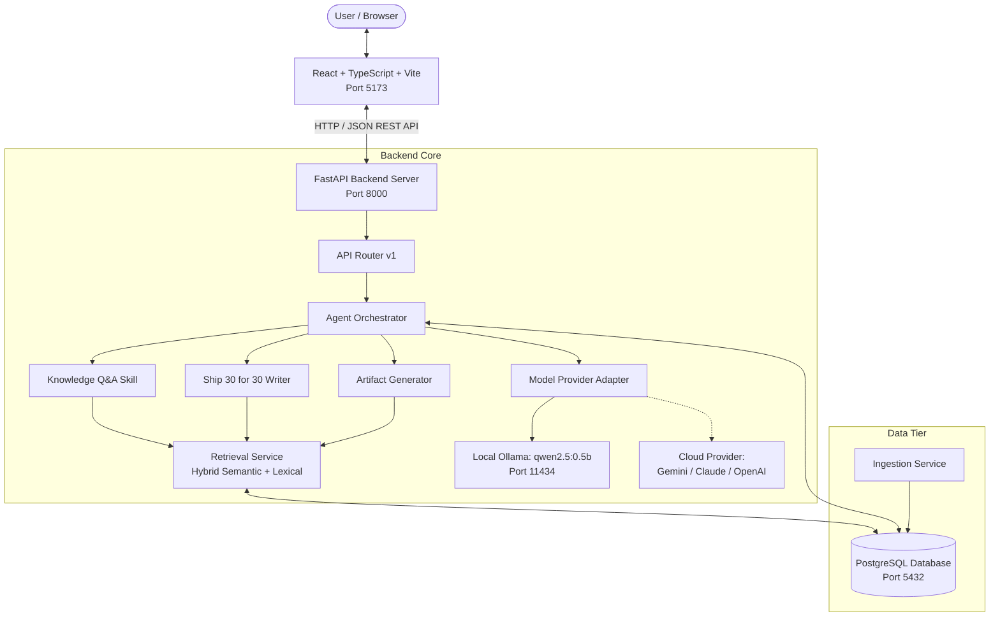

# System Architecture & Technical Specifications
## Project: The Lenny Growth Assistant
**Author:** Staff AI Engineer & Full-Stack Architect  
**Version:** 1.0.0

---

## 1. System Overview
The Lenny Growth Assistant is engineered as a decoupled, multi-tiered architecture combining a React + TypeScript frontend, a FastAPI Python backend, an evidence-grounded agent layer, PostgreSQL relational persistence, and hybrid vector/lexical knowledge retrieval.



---

## 2. Database Schema (PostgreSQL)

The database schema is defined via SQLAlchemy 2.0 and initialized automatically upon application startup.

### Entity Relationship Model:

```
[sessions] (1) <------- (N) [messages]
    |
    +------------------ (N) [artifacts]

[transcript_chunks] (Independent Knowledge Store)
```

### Table Definitions:

#### `sessions`
- `id` (VARCHAR(36), PK): UUID string.
- `title` (VARCHAR(255)): Conversational title (derived from first message).
- `provider` (VARCHAR(50)): Active inference provider (`local` | `cloud`).
- `model_name` (VARCHAR(100)): Model identifier.
- `created_at` (TIMESTAMP): Creation time.
- `updated_at` (TIMESTAMP): Last activity time.

#### `messages`
- `id` (VARCHAR(36), PK): UUID string.
- `session_id` (VARCHAR(36), FK -> sessions.id ON DELETE CASCADE): Session link.
- `role` (VARCHAR(20)): `user`, `assistant`, or `system`.
- `content` (TEXT): Message markdown body.
- `skill` (VARCHAR(50), Nullable): Executed skill name.
- `citations` (JSON): Serialized array of citation metadata objects.
- `created_at` (TIMESTAMP): Turn timestamp.

#### `transcript_chunks`
- `id` (VARCHAR(36), PK): UUID string.
- `doc_id` (VARCHAR(255), Index): File path / slug (e.g. `podcasts/molly-graham-2.md`).
- `doc_title` (VARCHAR(255)): Episode or newsletter title.
- `doc_url` (VARCHAR(500)): Canonical link on LennysNewsletter.com.
- `doc_type` (VARCHAR(50)): `podcast` or `newsletter`.
- `guest` (VARCHAR(255), Nullable): Interviewee name.
- `date` (VARCHAR(50), Nullable): Publication date.
- `chunk_index` (INTEGER): Chunk position within document.
- `speaker` (VARCHAR(255), Nullable): Active speaker extracted from timestamp tags.
- `text` (TEXT): Raw transcript excerpt.
- `embedding` (JSON): Normalized 256-dimensional semantic feature vector.
- `created_at` (TIMESTAMP): Ingestion timestamp.

#### `artifacts`
- `id` (VARCHAR(36), PK): UUID string.
- `session_id` (VARCHAR(36), FK -> sessions.id ON DELETE CASCADE): Session link.
- `title` (VARCHAR(255)): Artifact title.
- `format` (VARCHAR(20)): `markdown` or `html`.
- `content` (TEXT): Complete artifact payload.
- `created_at` (TIMESTAMP): Creation timestamp.
- `updated_at` (TIMESTAMP): Last edit timestamp.

---

## 3. Ingestion Pipeline & Hybrid Retrieval

### 1. Ingestion Pipeline (`IngestionService`)
- Recursively scans `data/transcripts/podcasts/` and `data/transcripts/newsletters/`.
- Extracts YAML frontmatter (`title`, `date`, `guest`, `post_url`, `description`).
- Normalizes speaker turn boundaries using regex `\*\*([^*]+)\*\*\s*\(([^)]+)\):`.
- Chunks text into overlapping segments (default: 1,000 characters, 200 character overlap).
- Computes deterministic, normalized 256-dimensional semantic projection vectors with sublinear term-frequency scaling.
- Safely deletes stale document chunks and commits new records to PostgreSQL in transactional batches.

### 2. Hybrid Retrieval Pipeline (`RetrievalService`)
- Computes dense vector representation of the user query.
- Tokenizes query keywords for lexical n-gram scoring.
- Scans candidate chunks and evaluates a hybrid scoring formula:
  $$\text{Score} = (0.65 \times \text{CosineSimilarity}) + (0.35 \times \text{LexicalOverlap})$$
- Filters matches exceeding the minimum relevance threshold ($\ge 0.22$).
- Sorts and returns top-$k$ verified citations ($k=5$).
- **Abstention Gate**: If all matches fall below the threshold, flags `is_empty = True`, triggering the honest limitation response.

---

## 4. Agent Framework & Skill Boundaries

The Agent Layer implements deterministic routing and strict skill specialization:

1. **Intent Classification**:
   - Analyzes keywords, user requests, and explicit skill parameters.
   - Maps requests into one of three dedicated execution skills:
     - `knowledge_qa`
     - `ship30_writer`
     - `artifact_generator`

2. **Knowledge Q&A Skill**:
   - Injects top-$k$ retrieved transcript passages into the prompt.
   - Requires inline citation markers `[1]`, `[2]` linked to structured source cards.
   - Enforces abstention when evidence is insufficient.

3. **Ship 30 for 30 Writing Skill**:
   - Implements Nicolas Cole & Dickie Bush digital writing principles.
   - Enforces a 6-part editorial structure: Headline, Hook, Friction/Tension, 3–4 Pillars with selective bolding, 3-Step Playbook, and 60-Second Takeaway.
   - Produces comprehensive, ~1,250-word pieces grounded in practitioner quotes.

4. **Artifact Generation Skill**:
   - Structures output into conversational context + a standalone code block: ````artifact:format[Title] ... ````.
   - Extracts and persists the artifact in the database while leaving the chat stream uncluttered.
   - Never executes generated code server-side.

---

## 5. Model Provider Abstraction
The system provides a uniform interface (`BaseLLMProvider`) implementing:
- `generate(prompt, system_prompt, temperature, max_tokens) -> ProviderResponse`
- `health_check() -> ProviderStatus`

### Provider Adapters:
- `OllamaProvider`: Connects to `http://localhost:11434` over async HTTP with configurable timeouts (default 90s), supporting installed models (e.g. `qwen2.5:0.5b`).
- `CloudProvider`: Connects to Google Gemini (via `google-generativeai`), Anthropic Claude, or OpenAI. Validates API keys without revealing them.

---

## 6. Security Model & Safe Rendering
1. **HTML Preview Isolation**:
   - Generated HTML/CSS code is rendered inside an `<iframe>` configured with `sandbox="allow-scripts"`.
   - `allow-same-origin` is **strictly omitted**, preventing the iframe from accessing cookies, authorization headers, or parent DOM storage.
2. **Safe Markdown Sanitization**:
   - User and assistant markdown is parsed using `marked` and sanitized with `DOMPurify`.
   - Only safe semantic markup tags are allowed.
3. **Zero Server Code Execution**:
   - No Python `eval()`, `exec()`, or containerized code execution occurs on the server.
4. **Secret Management**:
   - API keys are read from environment variables; zero credentials stored in database rows or client responses.

---

## 7. API Endpoints Contract (v1)

| Method | Path | Description |
| :--- | :--- | :--- |
| `GET` | `/health` | System readiness check (database, Ollama, chunk count). |
| `GET` | `/api/v1/health` | Deep diagnostic status for all dependencies. |
| `GET` | `/api/v1/models` | List of available local and cloud models and status. |
| `POST` | `/api/v1/sessions` | Create a new isolated conversation session. |
| `GET` | `/api/v1/sessions` | List saved sessions with message counts and timestamps. |
| `GET` | `/api/v1/sessions/{id}` | Retrieve session details and full turn history. |
| `DELETE`| `/api/v1/sessions/{id}` | Delete session and cascade delete its messages/artifacts. |
| `POST` | `/api/v1/chat` | Send message, execute agent skill, and persist turn. |
| `GET` | `/api/v1/artifacts/{id}`| Fetch generated artifact by ID. |
| `GET` | `/api/v1/artifacts/session/{id}` | List all deliverables generated within a session. |
| `POST` | `/api/v1/ingestion/run`| Trigger background re-ingestion of transcript corpus. |
| `GET` | `/api/v1/ingestion/status` | Check indexed chunk counts and document coverage. |
